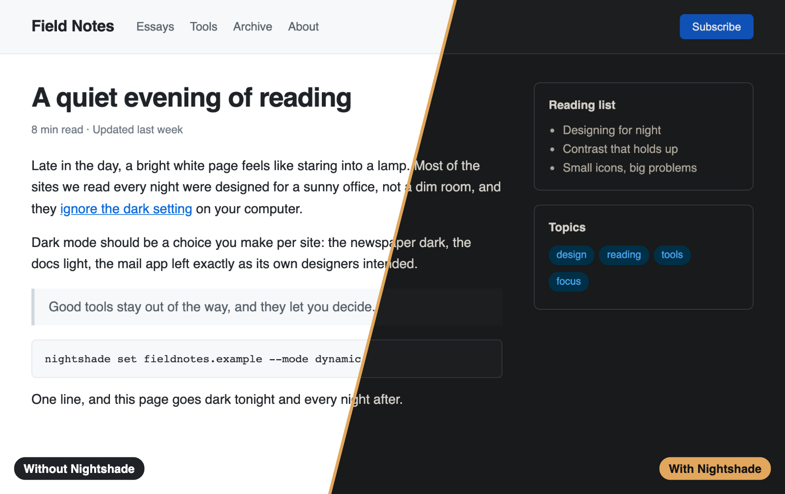
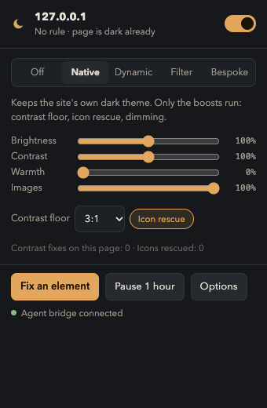
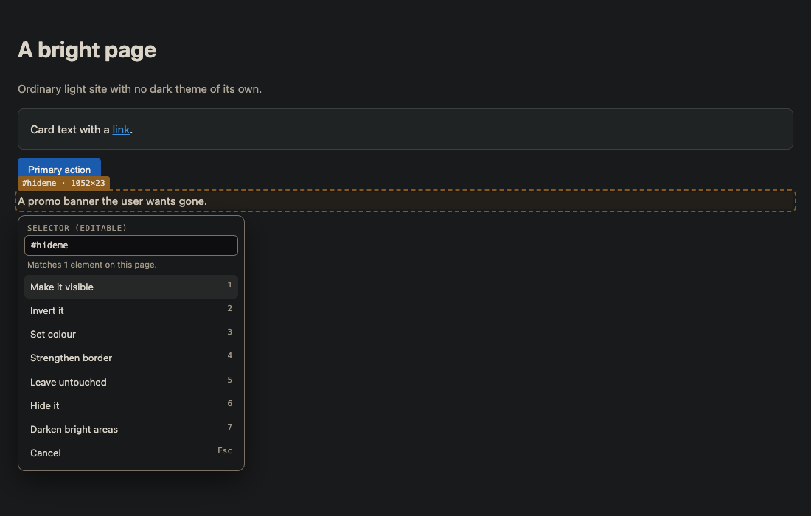

<p align="center">
  
</p>

<h1 align="center">Nightshade</h1>

<p align="center">
  <b>A Chrome extension for per-site dark mode that you, or your AI agent, control.</b><br>
  Pick which sites go dark and in which colours. Keep the sites that already have a good dark theme, and fix what their themes break.
</p>

<p align="center">
  <a href="https://github.com/sahajamit/nightshade/releases/latest"></a>
  <a href="https://github.com/sahajamit/nightshade/actions/workflows/ci.yml"></a>
  <a href="LICENSE"></a>
  
  
</p>

<p align="center">
  <a href="#install">Install</a> ·
  <a href="#use-it-with-your-ai-agent">Agent setup</a> ·
  <a href="#why-nightshade">Why</a> ·
  <a href="AGENTS.md">Agent guide</a> ·
  <a href="SECURITY.md">Security</a>
</p>

<p align="center">
  
</p>

## Contents

- [Why Nightshade](#why-nightshade)
- [Features](#features)
- [Install](#install)
- [Use it with your AI agent](#use-it-with-your-ai-agent)
- [Everyday use](#everyday-use)
- [Configuration](#configuration)
- [Privacy and permissions](#privacy-and-permissions)
- [Development](#development)
- [Known limits](#known-limits)
- [Credits and licence](#credits-and-licence)

## Why Nightshade

Bright screens strain my eyes, so I used [Dark Reader](https://chromewebstore.google.com/detail/dark-reader/eimadpbcbfnmbkopoojfekhnkhdbieeh), the best-known dark-mode extension, for years. Three things kept bothering me:

- **Trust.** A dark-mode extension reads and changes every page you open, including your inbox, your bank and your work tools. Store extensions update themselves silently, you never see the code, and they can change owners overnight. With AI agents now browsing and running tools for us, I wanted code I could read and build myself.
- **Clicking through every site by hand.** Sites with a good dark theme of their own (Gmail, LinkedIn, X) should be left alone, with only what their themes break fixed. Others should go dark, and a few should use my own colours. Getting there meant a popup per site, with settings locked inside the extension.
- **I wanted to just tell my agent.** "Dark mode on these three sites, everything else light" or "Dracula colours on GitHub" should be one sentence, not ten minutes of clicking.

So Nightshade is open source, never updates itself behind your back, keeps every setting in one plain JSON file, and comes with a CLI and a skill so any coding agent can change it for you.

## Features

| | |
| --- | --- |
| **One rule per site** | Each site gets its own mode, sliders, palette, custom CSS and element fixes. The most specific rule wins (`mail.google.com/mail` beats `mail.google.com` beats `google.com`). |
| **Five modes** | *Off*, *Native* (keep the site's own dark theme), *Dynamic* (Dark Reader's colour engine), *Filter* (full-page invert, for canvas apps like Google Docs) and *Bespoke* (your own palette, such as Dracula). |
| **Fixes for broken dark themes** | A contrast floor lifts dim text, icons and checkbox borders to 3:1, 4.5:1 or 7:1. Icon rescue lightens small dark icons. Both work by role and size, not class names, so they survive site redesigns. |
| **Point and fix** | Click anything broken and choose *make visible*, *invert*, *set colour*, *strengthen border*, *leave untouched*, *hide* or *darken bright areas* (for a white panel on a dark site, like an open email). The fix is saved with a stable selector. |
| **Agent-ready** | One JSON file, a CLI that validates every change, a bridge that updates open tabs within a second, and a skill for Claude Code, Codex, Gemini CLI and Cursor. |
| **Private by design** | No analytics, no server, no remote code. MIT licensed. |

<table>
  <tr>
    <td align="center" width="34%"><br><sub>The popup: one site at a time</sub></td>
    <td align="center" width="66%"><br><sub>The element picker: fix one broken thing</sub></td>
  </tr>
</table>

## Install

Nightshade is not on the Chrome Web Store. Loading it yourself takes a minute:

1. Download `nightshade-<version>.zip` from the [latest release](https://github.com/sahajamit/nightshade/releases/latest).
2. Unzip it somewhere you will keep it. Chrome loads the extension from that folder every time it starts.
3. Open `chrome://extensions`, switch on **Developer mode**, click **Load unpacked** and choose the unzipped folder.

That's it. Sites without a rule get the default: light sites go dark, sites that are already dark are left alone.

A few notes:

- It works the same in Chromium, Brave and Edge. Repeat step 3 in each browser profile you use.
- Switch off Dark Reader or any other dark-mode extension so the two don't stack.
- Chrome may remind you about developer-mode extensions at startup. That is normal for any extension loaded this way.
- To update, replace the folder's contents with a new release and click reload on Nightshade's card. Your settings are kept.
- Each release also has `SHA256SUMS.txt` to verify the download.

<details>
<summary><b>Build from source instead</b></summary>

```sh
git clone https://github.com/sahajamit/nightshade.git
cd nightshade
npm install
npm run build
```

Then **Load unpacked** and choose `dist/extension`.

</details>

## Use it with your AI agent

Three commands, once. They need Node 20 or newer.

```sh
npm link                      # puts `nightshade` on your PATH (from a source checkout)
nightshade bridge install     # live updates from the config file into open tabs
nightshade skill install      # tells your coding agents that Nightshade is here
```

Using the release instead of a checkout? Unzip `nightshade-cli-<version>.zip` and run `node cli/nightshade.mjs` wherever this page says `nightshade`. Then open Nightshade's options page, **Agent bridge**, **Reconnect** (or restart Chrome).

Now start a new agent session and just ask, from any folder:

| You say | Your agent runs |
| --- | --- |
| "Only darken the sites I list" | `nightshade global --unlisted only-listed` |
| "Dark mode on GitHub" | `nightshade on github.com` |
| "Use Dracula colours on GitHub" | `nightshade palette set dracula --bg '#282a36' ...` then `nightshade set github.com --mode bespoke --palette dracula` |
| "Keep Gmail's own dark theme, but the open email is still white" | `nightshade set mail.google.com --mode native` then `nightshade fix add mail.google.com body darken` |
| "Checkboxes on Gmail are hard to see" | `nightshade fix add mail.google.com '[role=checkbox]' strengthen-border` |
| "Warmer, it's late" | `nightshade global --warmth 20` |

Every command validates before it writes and supports `--json`. Changes made in the popup are written back to the same file, so the file is always the full picture. Without the bridge, the extension works on its own and the options page imports and exports the file.

<details>
<summary><b>Where the skill is installed, and options</b></summary>

`nightshade skill install` copies [skills/nightshade/SKILL.md](skills/nightshade/SKILL.md) into the skills folder of every coding agent it finds:

| Agent | Skill goes to |
| --- | --- |
| Claude Code | `~/.claude/skills/nightshade/` |
| Codex, Gemini CLI | `~/.agents/skills/nightshade/` (both read this shared folder) |
| Cursor | `~/.cursor/skills/nightshade/` |

- `--agent claude,codex` installs for those agents only.
- `--pointer` also adds one line to the agent's global instructions file (`~/.claude/CLAUDE.md`, `~/.codex/AGENTS.md`, `~/.gemini/GEMINI.md`).
- `nightshade skill status` shows what is installed; `nightshade skill uninstall` removes only what Nightshade wrote.
- If `nightshade` is not on your PATH, the installed skill names the exact command to run instead. Run `skill install` again after moving or updating your copy.

Any other agent can read the same file, or [AGENTS.md](AGENTS.md), the full guide.

</details>

<details>
<summary><b>How the bridge works</b></summary>

The bridge is a small native-messaging host (macOS and Linux for now) that watches `~/.nightshade/config.json` and syncs it with the extension both ways. It only accepts Nightshade's extension ID, `cilhiaedhodolblheagjkpjgfnananpf`, which is the same for every build because the manifest carries a fixed public key. Details in [docs/agent-bridge.md](docs/agent-bridge.md).

</details>

## Everyday use

| Where | What |
| --- | --- |
| Toolbar popup | Mode for this site, brightness, contrast, warmth, image brightness, contrast floor, icon rescue, palette, pause for an hour |
| `Alt+Shift+N` | Turn Nightshade on or off for this site |
| `Alt+Shift+P`, or right-click, *Nightshade: fix this element* | Fix one element |
| Options page | All site rules, global defaults, palettes, the raw config, bridge status |

## Configuration

Everything lives in `~/.nightshade/config.json`:

```json
{
  "version": 1,
  "global": { "unlisted": "skip-already-dark", "mode": "dynamic", "contrastFloor": 3, "iconRescue": true },
  "palettes": { "lamplight": { "bg": "#1b1d21", "text": "#ece6dc", "...": "..." } },
  "sites": [
    { "match": ["mail.google.com"], "mode": "native", "contrastFloor": 4.5,
      "fixes": [{ "selector": "[role=checkbox]", "action": "strengthen-border" }] },
    { "match": ["docs.google.com"], "mode": "filter" }
  ]
}
```

`nightshade schema` prints every field and its allowed values. `nightshade validate` checks a file without changing anything. `nightshade help` lists every command.

## Privacy and permissions

Nightshade runs on every site (`<all_urls>`) because dark mode has to restyle whatever page you open, and Dark Reader's engine needs to read the stylesheets and images a page loads from other origins. It has no analytics, talks to no server of its own and loads no remote code. The `nativeMessaging` permission is used only by the optional bridge and does nothing until you run `nightshade bridge install`.

[SECURITY.md](SECURITY.md) lists each permission, the trust boundaries, and how to report a vulnerability privately.

## Development

```sh
npm run build        # dist/extension, dist/cli, dist/bridge
npm run watch
npm run typecheck
npm test             # unit tests (vitest)
npm run test:e2e     # loads the extension in Playwright's Chromium against local fixtures
npm run package      # release zips in release/
npm run icons        # regenerate every icon from assets/logo/nightshade-logo.png
npm run update-fixes # refresh the vendored Dark Reader fix lists
```

<details>
<summary><b>Source layout</b></summary>

```
src/shared         config model, validation, URL matching, colour maths, CSS generation
src/background     service worker: rule resolution, Dark Reader fix lists, image analysis, bridge client
src/content        content script: modes, dark-page detection, boosts, element picker
src/popup          toolbar popup
src/options        options page
src/cli            the nightshade CLI
src/bridge         native-messaging host that syncs the config file
skills/nightshade  the agent skill installed by `nightshade skill install`
vendor/darkreader  Dark Reader's community site-fix lists (MIT)
assets/logo        master logo; icons are derived from it
```

</details>

Pushing a tag like `v0.1.0` (matching `package.json`) runs the release workflow, which builds, tests and attaches the zips to a GitHub release. Read [CONTRIBUTING.md](CONTRIBUTING.md) before sending a pull request.

## Known limits

- Chrome doesn't let extensions run on `chrome://` pages or the Chrome Web Store.
- A few CSS-in-JS sites that change styles only through the CSSOM may update their dark colours a beat late, because Dark Reader's page-world stylesheet proxy can't be injected from a content script.
- Already-dark detection runs once per page load. A single-page app that switches theme later needs a rule.

## Credits and licence

MIT. Nightshade is an independent project, not affiliated with or endorsed by Dark Reader. It bundles the [darkreader](https://www.npmjs.com/package/darkreader) library and vendors Dark Reader's site-fix lists, both MIT-licensed by Dark Reader Ltd. See [THIRD_PARTY_NOTICES.md](THIRD_PARTY_NOTICES.md).
