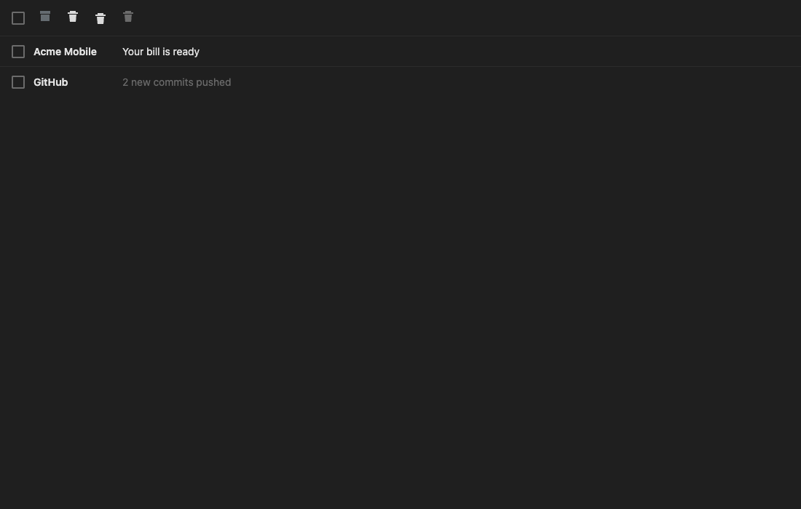

# Nightshade

Per-site dark mode for Chrome that you control site by site, from a popup or from your AI agent.

Nightshade is built on [Dark Reader](https://github.com/darkreader/darkreader)'s colour engine. What it adds:

- **One rule per site.** Each site gets its own mode, sliders, palette, custom CSS and element fixes. The most specific rule wins (`mail.google.com/mail` beats `mail.google.com` beats `google.com`).
- **Five modes.** Off, Native (keep the site's own dark theme), Dynamic (Dark Reader recolouring), Filter (full-page invert, for canvas apps like Google Docs) and Bespoke (your own palette).
- **Boosts that fix what dark themes break.** A contrast floor lifts dim text, icons and checkbox borders until they reach 3:1, 4.5:1 or 7:1. Icon rescue lightens small dark glyph images. Both find elements by role and size, not by class names, so they keep working when a site ships new CSS.
- **Fix an element.** Point at anything broken, pick *make visible*, *invert*, *set colour*, *strengthen border*, *leave untouched* or *hide*. The fix is saved to that site's rule with a stable selector.
- **Agent-friendly by design.** All settings live in one JSON file (`~/.nightshade/config.json`) with a CLI that validates every change. An optional native-messaging bridge pushes file changes into open tabs within a second, so "make LinkedIn warmer" is one command for an agent.



## Install (from source)

```sh
git clone https://github.com/sahajamit/nightshade.git
cd nightshade
npm install
npm run build
```

Then in Chrome: open `chrome://extensions`, switch on **Developer mode**, click **Load unpacked** and choose `dist/extension`. Do this in each Chrome profile where you want it.

If you also run Dark Reader or another dark-mode extension, switch it off so the two don't stack.

### The CLI and the agent bridge (optional)

```sh
npm link                      # puts `nightshade` on your PATH
nightshade bridge install     # registers the bridge with Chrome, Chromium, Brave and Edge
```

Open Nightshade's options page → **Agent bridge** → **Reconnect** (or restart Chrome). From then on:

```sh
nightshade set linkedin.com --mode native --contrast-floor 4.5
nightshade set example.com --mode bespoke --palette lamplight --warmth 15
nightshade fix add mail.google.com '[role=checkbox]' strengthen-border
nightshade off mybank.example
nightshade site https://mail.google.com/   # what applies here, and why
nightshade show --json
```

Changes made in the popup are written back to the same file, so the file is always the full picture. Without the bridge, the extension works on its own and the options page can import and export the file.

See [AGENTS.md](AGENTS.md) for the guide written for AI agents, and [docs/agent-bridge.md](docs/agent-bridge.md) for how the bridge works.

## Using it

| Where | What |
| --- | --- |
| Toolbar popup | Mode for this site, brightness, contrast, warmth, image brightness, contrast floor, icon rescue, palette, pause for an hour |
| `Alt+Shift+N` | Turn Nightshade on or off for this site |
| `Alt+Shift+P`, or right-click → *Nightshade: fix this element* | Fix one element |
| Options page | All site rules, global defaults, palettes, the raw config, bridge status |

Sites without a rule follow the global default. Out of the box that means: recolour light sites with Dynamic mode, and leave sites that are already dark alone (only the boosts run there).

## Configuration

```json
{
  "version": 1,
  "global": { "unlisted": "skip-already-dark", "mode": "dynamic", "contrastFloor": 3, "iconRescue": true },
  "palettes": { "lamplight": { "bg": "#1b1d21", "text": "#ece6dc", "...": "..." } },
  "sites": [
    { "match": ["mail.google.com"], "mode": "native", "contrastFloor": 4.5,
      "fixes": [{ "selector": "[role=checkbox]", "action": "strengthen-border" }] },
    { "match": ["docs.google.com"], "mode": "filter" }
  ]
}
```

`nightshade schema` prints every field with its allowed values. `nightshade validate` checks a file without touching anything.

## Development

```sh
npm run build        # dist/extension, dist/cli, dist/bridge
npm run watch
npm run typecheck
npm test             # unit tests (vitest)
npm run test:e2e     # loads the extension in Playwright's Chromium against local fixtures
node test/e2e/run.mjs --real   # also visits a few public sites and saves screenshots
```

Source layout:

```
src/shared      config model, validation, URL matching, colour maths, CSS generation
src/background  service worker: rule resolution, Dark Reader fix lists, image analysis, bridge client
src/content     content script: modes, dark-page detection, boosts, element picker
src/popup       toolbar popup
src/options     options page
src/cli         the nightshade CLI
src/bridge      native-messaging host that syncs the config file
vendor/darkreader  Dark Reader's community site-fix lists (MIT)
```

`npm run update-fixes` refreshes the vendored Dark Reader lists from upstream.

### Known limits

- Chrome doesn't let extensions run on `chrome://` pages or the Chrome Web Store.
- Dark Reader's page-world stylesheet proxy can't be injected from a content script, so a few CSS-in-JS sites that only change styles through the CSSOM may update their dark colours a beat late.
- Already-dark detection runs once per page load. A single-page app that changes theme later needs a rule.

## Credits and licence

MIT. Nightshade bundles the [darkreader](https://www.npmjs.com/package/darkreader) library and vendors Dark Reader's site-fix lists, both MIT-licensed by Dark Reader Ltd. See [THIRD_PARTY_NOTICES.md](THIRD_PARTY_NOTICES.md).
